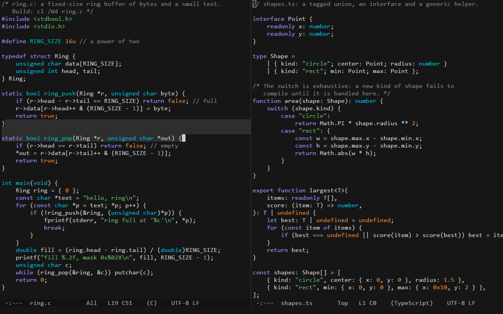
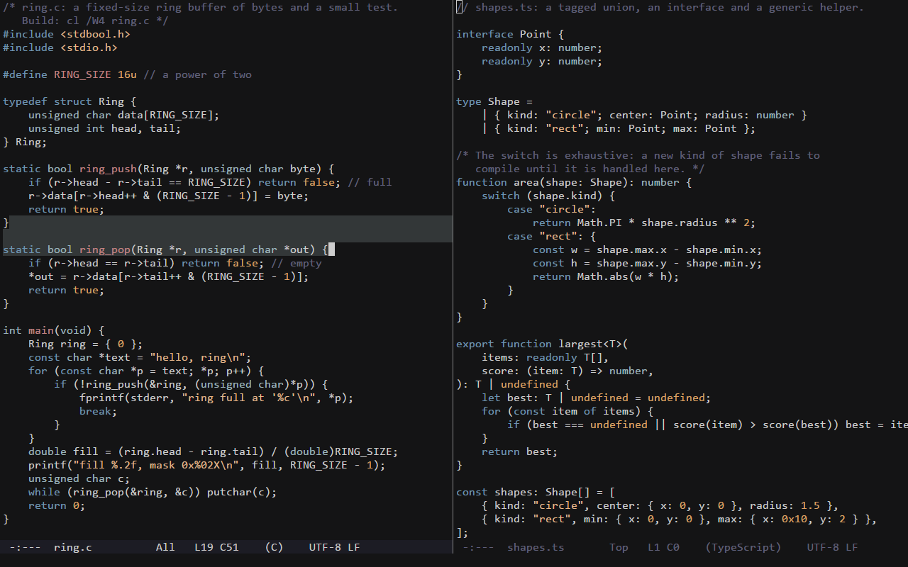
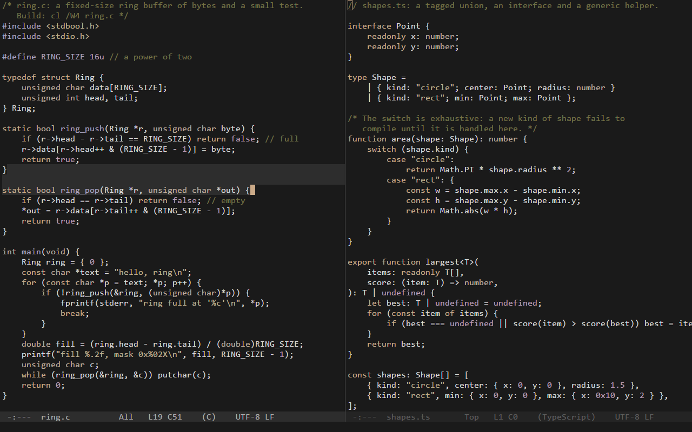

# ronin

A small, fast, Emacs-style code editor for Windows, written in C with no dependencies.

**[Install](#install)** · **[Keys](#first-five-minutes)** · **[Configuration](#configuration)** ·
**[Themes](#themes)** · **[Contributing](CONTRIBUTING.md)**


## Why

ronin keeps three goals in a fixed order: input latency and speed first, a small and simple program
second, features third. A keystroke's command and its frame take about 20 microseconds; an idle ronin
draws nothing and uses no CPU; the whole editor is one executable of under half a megabyte that needs
nothing but Windows. It looks and works like Emacs as Jonathan Blow uses it, with ideas from the Focus and 4coder
editors: no tabs, menus, toolbars or scroll bars; windows side by side, an inverse-video mode line, a
minibuffer, a block cursor, and Emacs' default keys.

## What it does

- Emacs editing: point and mark, the kill ring (linked to the clipboard), undo and undo-redo, isearch,
  query-replace, M-x, automatic indentation.
- Multiple cursors, as in Emacs' multiple-cursors package: typing at 10,000 cursors takes ~2 ms a key.
- Highlighting for Jai, C, C++, C#, JavaScript and TypeScript by hand-written lexers.
- Projects: a fuzzy file finder, project-wide search on background threads, builds with jump to
  error, a read-only view of git's changes, and a terminal or an AI assistant's command line one key away.
- A command list (`C-S-p`): every command with what it does and its keys.
- One text configuration file, applied as soon as it is saved; every key can be rebound; five themes.
- Files: UTF-8 and UTF-16, line endings kept byte for byte, a 100 MB file opens in ~40 ms; crash recovery.

## Install

1. Download the latest `ronin-<version>-windows-x64.zip` from
   [Releases](https://github.com/Bskasan/ronin-text-editor/releases).
2. Unzip it anywhere and run `ronin.exe`. Windows 10 or later, x64; there is no installer and no runtime
   to install.

The exe is not signed, so the first start may show "Windows protected your PC" (SmartScreen): choose
**More info**, then **Run anyway**. Or build it yourself: see [CONTRIBUTING.md](CONTRIBUTING.md#building).

From a terminal:

```
ronin file.c                 open a file (as many as you like; the first is shown)
ronin +120:8 file.c          open it at line 120, column 8 (1-based, as in Emacs)
ronin C:\code\project        open a directory as the project
ronin --version              print the version and exit
```

A file that does not exist is created when you save it. `samples\` in the repository has one small file per
language to try the highlighting and the indentation on.

## First five minutes

Keys are written as in Emacs: `C-` is Ctrl, `M-` is Alt, `S-` is Shift; `RET` is Enter, `SPC` the space bar,
`DEL` Backspace; `C-x C-s` means Ctrl+X, then Ctrl+S. A key matches by the character it types in your keyboard
layout: `C-/` is Ctrl with whichever key types `/`. Unlike Emacs, `ESC` cancels (as `C-g` does).

| keys | command | what it does |
|---|---|---|
| `C-f` `C-b` `C-n` `C-p` (or the arrows) | `forward-char` `backward-char` `next-line` `previous-line` | move by a character or a line |
| `C-x C-f` | `find-file` | open a file, with completion |
| `C-x C-s` | `save-buffer` | save |
| `C-x C-c` | `save-buffers-kill-terminal` | quit, asking about unsaved files |
| `C-g` | `keyboard-quit` | cancel whatever is going on |
| `C-/` `C-?` | `undo` `undo-redo` | undo, and go forward again |
| `C-SPC` | `set-mark-command` | start a region (or hold Shift while moving) |
| `C-w` `M-w` `C-y` | `kill-region` `kill-ring-save` `yank` | cut, copy, paste |
| `C-s` `C-r` | `isearch-forward` `isearch-backward` | search as you type |
| `M-%` | `query-replace` | replace, asking at each match |
| `C-x b` | `switch-to-buffer` | another open file |
| `C-x 3` `C-x o` `C-x 1` | `split-window-right` `other-window` `delete-other-windows` | windows side by side |
| `M-x` | `execute-extended-command` | run any command by name |
| `C-S-p` | `show-command-list` | every command, what it does and its keys; type to filter, `RET` runs |
| `C-h k` | `describe-key` | what a key does |
| `C-c ,` | `open-config` | open the configuration file |

M-x and `C-S-p` list every command; the complete default bindings, with comments, are
[src/editor/config_default.h](src/editor/config_default.h), the file `C-c ,` writes for you.


## Configuration

ronin reads `ronin.conf` next to `ronin.exe` if that file exists (a portable install), otherwise
`%APPDATA%\ronin\ronin.conf`. `C-c ,` opens it, creating it the first time with every setting, color and binding
explained in comments. ronin applies the file as soon as it is saved, from ronin or any other program (`C-c r`
reloads it by hand). A file needs only what it changes; a bad line is reported in the echo area and in
`*Messages*` with its line number, and the rest still applies.

```ini
[settings]
font      = Cascadia Mono
font_size = 13
theme     = moonfly

[keys]
<f5>        recompile
C-c g       goto-line
```

The settings most often changed:

| setting | default | what it does |
|---|---|---|
| `font` | `Consolas` | a monospace font (Consolas when it is missing) |
| `font_size` | `12` | points, 4 to 96; `C-x C-+` and `C-x C--` change it for the session |
| `theme` | `ronin` | the color theme (see [Themes](#themes)) |
| `tab_width` | `4` | columns per tab stop |
| `indent_width` | `4` | columns per indentation level |
| `indent_with_tabs` | `false` | indent with tabs instead of spaces (a file's own style is detected when it loads) |
| `render_mode` | `symmetric` | ClearType: `symmetric`, `natural` or `classic` (crisper, narrower) |
| `delete_selection_mode` | `false` | typing replaces an active region |
| `startup_windows` | `1` | 2 starts with two windows side by side |
| `early_window` | `false` | show the window in its background color before the graphics device is ready |
| `ai_provider` | `claude` | the AI tool `C-c a` runs: `claude`, `openai` (codex) or `custom` (`ai_command`) |
| `terminal` | `auto` | the terminal `C-c t` opens: `wt` (Windows Terminal), `cmd` or `auto` |

The others (projects, search, builds, git, undo, the kill ring and more) are in the file `C-c ,` writes.

In `[keys]` a line is a key sequence and a command, the command last; the command `none` removes a binding.
`[keys minibuffer]`, `[keys isearch]`, `[keys search-results]`, `[keys compilation]`, `[keys command-list]` and
`[keys git-changes]` hold the keys that come first in those places.

When several keyboard layouts are installed, Windows' Left Alt+Shift hotkey can switch the layout while you type a
Meta key with Shift (`M-<`, `M-%`); turn that hotkey off in the Windows settings if it gets in the way.

## Themes

| moonfly | oxide |
|---|---|
|  |  |
| **vague** | **mellifluous** |
|  |  |

Five themes are built in: `ronin` (the default, Jonathan Blow's colors, in the picture at the top), and `moonfly`,
`oxide`, `vague` and `mellifluous`, ported from Neovim color schemes. Pick one with `theme = vague` in
`[settings]`, or try them with `M-x set-theme`, which switches for the session only and completes over every theme
there is.

A theme of your own is a file `themes\<name>.conf` next to `ronin.conf` (`%APPDATA%\ronin\themes\` in a normal
install) with a `[theme]` block and the colors it sets; a file with a built-in theme's name replaces it. Theme files
are watched like `ronin.conf`.

```ini
[theme]
name    = dusk
source  = where it comes from
license = its license
author  = who made it

[colors]
background = #1b1d22
text       = #c8c8c8
keyword    = #8fb4d8
comment    = #6b7280
```

Every color is optional: one the theme leaves out keeps ronin's or follows the color it derives from (`function`
follows `keyword`, `constant` follows `number`, the selected mode line is `text` on `background`, ...; the file
`C-c ,` writes lists every key). A line in `ronin.conf`'s `[colors]` pins one color over any theme; a `ronin.conf`
written before themes existed lists them all, so remove that section to let themes show (ronin says how many keys
it overrides).

The four ported themes take only their color values and names from
[bluz71/vim-moonfly-colors](https://github.com/bluz71/vim-moonfly-colors),
[oxidescheme/nvim](https://github.com/oxidescheme/nvim), [vague-theme/vague.nvim](https://github.com/vague-theme/vague.nvim)
and [ramojus/mellifluous.nvim](https://github.com/ramojus/mellifluous.nvim), each under the MIT license: see
[THIRD_PARTY.md](THIRD_PARTY.md).

## Projects

A project is the nearest directory above a file that holds `.git`, `.hg`, `.svn` or `.ronin-project`, or a
directory given on the command line. It is scanned on a background thread; `.gitignore` files (a subset of the
syntax) and `.ronin-project` decide what is listed, and it is scanned again when files come or go
(`M-x project-refresh` forces it).

| keys | command | what it does |
|---|---|---|
| `C-x p f` | `project-find-file` | find a file of the project by fuzzy matching its path |


## Search

isearch highlights every match on screen, follows smart case (a capital letter makes it exact) and wraps around;
query-replace keeps the case of each match, and one undo takes back a whole session. The project-wide search reads
the files on background threads and lists the matches in `*search*` while it runs; buffers with unsaved changes are
searched as they are in ronin.

| keys | command | what it does |
|---|---|---|
| `C-s` `C-r` | `isearch-forward` `isearch-backward` | search forward / backward as you type |
| `M-%` | `query-replace` | replace from point, asking at each match |
| `C-x p g` | `project-search` | search every file of the project for a literal text |
| `M-s o` | `occur` | the lines of this buffer that contain a text, in `*occur*` |
| `M-g n` `M-g p` | `next-error` `previous-error` | the next / previous match (or build error) from any window |

While isearch runs:

<!-- keymap: isearch -->
| keys | command | what it does |
|---|---|---|
| `C-s` `C-r` | `isearch-repeat-forward` `isearch-repeat-backward` | the next / previous match |
| `C-w` | `isearch-yank-word` | add the next word at point to the search |
| `M-c` | `isearch-toggle-case-fold` | switch between exact case and either case |
| `RET` | `isearch-exit` | stay at the match (the mark is left where the search started) |
| `C-g` | `isearch-abort` | go back to where the search started |

In `*search*` and `*occur*`:

<!-- keymap: search-results -->
| keys | command | what it does |
|---|---|---|
| `RET` | `compile-goto-error` | visit the match in another window |
| `n` `p` | `next-error-no-select` `previous-error-no-select` | show the next / previous match in another window |
| `g` | `recompile` | search again |
| `q` | `quit-window` | close the results window |


## Builds

`C-x p c` asks for a build command (the one last used in the project, else the `[build]` command of
`.ronin-project`, ready to edit) and runs it in the project's root; its output fills `*compilation*` in another
window while you keep typing. Errors and warnings of MSVC, GCC, Clang, tsc and Jai are recognized and colored, and
`M-g n` walks them. Buffers with unsaved changes are asked about first, and files the build rewrote are reloaded.

| keys | command | what it does |
|---|---|---|
| `C-x p c` | `project-compile` | build the project |

<!-- keymap: compilation -->
| keys | command | what it does |
|---|---|---|
| `RET` | `compile-goto-error` | visit the error on this line |
| `g` | `recompile` | run the command again |
| `C-c C-k` | `kill-compilation` | stop it, with every process it started |

```ini
[build]
command   = .\build.bat release
directory = src
```

That is a `.ronin-project` at the project's root; `directory` is relative to the root and optional. (Write
`.\build.bat` rather than `build.bat`: cmd does not look in the current directory when
`NoDefaultCurrentDirectoryInExePath` is set.) Nothing runs before you press `RET`.


## git

`C-x g` shows the uncommitted changes of the project's git work tree in a box over the windows: every file git
status lists, with its two-letter status, and the selected file's diff against HEAD. It only reads (nothing is
staged, committed or reverted); git runs in the background, so typing never waits for it.

| keys | command | what it does |
|---|---|---|
| `C-x g` | `show-git-changes` | the changed files and their diffs |

<!-- keymap: git-changes -->
| keys | command | what it does |
|---|---|---|
| `TAB` | `modal-other-pane` | from the files to the diff and back |
| `RET` | `modal-accept` | visit the selected file at its first change |
| `g` | `git-changes-refresh` | run git status again |
| `C-g` | `keyboard-quit` | close the box |


## Terminals

| keys | command | what it does |
|---|---|---|
| `C-c t` | `open-terminal` | a terminal in the current file's directory |
| `C-c a` | `open-ai-terminal` | a terminal in the project's root running an AI assistant's command line tool |

`C-c a` runs `claude` (Claude Code) by default, `codex` with `ai_provider = openai`, or any command with
`ai_provider = custom` and `ai_command`. Windows Terminal is used when `wt.exe` is on PATH, the classic console
otherwise (`terminal` chooses). ronin starts the terminal and lets it go: it stays open after ronin ends.

## Multiple cursors

The commands of Emacs' multiple-cursors package, without its `mc/` prefix. Typing, motions, kills, yanks and
indentation then act at every cursor, in one undo step; `C-g` first deactivates their regions, then leaves one
cursor. Ctrl+Shift+click adds a cursor or removes the one there.

| keys | command | what it does |
|---|---|---|
| `C->` `C-<` | `mark-next-like-this` `mark-previous-like-this` | a cursor at the next / previous occurrence of the region, or on the next / previous line |
| `C-c C-<` | `mark-all-like-this` | a cursor at every occurrence of the region |
| `C-S-c C-S-c` | `edit-lines` | a cursor on every line of the region |


## Known limits

- Monospace text on a cell grid: no proportional fonts, ligatures, bold or italic; wide (East Asian) characters
  and emoji show as a box; no fallback font for characters the font lacks.
- No line wrapping (long lines scroll horizontally), no line numbers, no cursor blink, no smooth scrolling.
- No language server and no parser: highlighting and indentation come from hand-written lexers and simple rules,
  for six languages. comment-line uses `//` in every language.
- Search is for literal text only: no regular expressions, no whole-word search, no project-wide replace.
- Missing Emacs features: prefix arguments (`C-u`), the mark ring, rectangles, overwrite mode, auto-save, `ESC` as
  Meta.
- Encodings: UTF-8, and UTF-16 with a byte order mark; anything else is shown and saved as raw bytes. Files over
  1 GB are refused.
- At most 8 windows. One build at a time, with no input to it and only the built-in error formats.
- The git changes view only reads, needs git 2.15 or later, and does not scroll diffs sideways.
- Themes are colors only, and the built-in ones are dark: ClearType is blended for light text on a dark background.
- Terminals: Windows Terminal or the classic console only.
- Crash recovery is a best effort: it writes the unsaved files only when ronin itself crashes, not when the process
  is ended from outside or the power fails.

The full list, with the reasons, is the "Later" section of [docs/ARCHITECTURE.md](docs/ARCHITECTURE.md#later).

## Roadmap

What may come after 1.0, in no fixed order and without dates:

- Editing: auto-save, prefix arguments (`C-u`), the mark ring, rectangles, `ESC` as Meta.
- Search: regular expressions, whole-word search, project-wide replace, a match count in isearch.
- Text: legacy code pages and UTF-16 without a byte order mark, wide characters and emoji, a fallback font, line
  numbers.
- Speed on extreme input: very long lines, and saving on a background thread.
- Projects and builds: an index kept current from change notifications, run and debug commands, several build
  commands per project, user-defined error formats.
- git: staging, committing and reverting from the git changes view.
- Windows: undo of window changes.

Not planned, by design: a language server or tree-sitter, proportional fonts, ligatures, bold and italic, tabs,
menus, toolbars and scroll bars.

## Contributing

Bug reports and pull requests are welcome; read [CONTRIBUTING.md](CONTRIBUTING.md) first. A feature starts as an
issue, before any code, because the priority order (latency and speed, then small and simple, then features)
decides what gets in. How ronin is designed, every decision and every measurement are in
[docs/ARCHITECTURE.md](docs/ARCHITECTURE.md).

## License and credits

MIT; see [LICENSE](LICENSE).

ronin is inspired by Jonathan Blow's Emacs setup, whose colors are the default theme, by the Focus and 4coder
editors, and by GNU Emacs (the editing model, the default keys, the command names and many messages). The
naysayer-theme for Emacs and the Witness color scheme served as references for the colors, and the fuzzy finder's
scoring weights follow fzf's. ronin is not affiliated with or endorsed by any of these projects or their authors.
The four ported themes are credited in [THIRD_PARTY.md](THIRD_PARTY.md).

ronin's code is written with Claude Code, under the direction and review of its owner; the Co-Authored-By line in
every commit says so.
