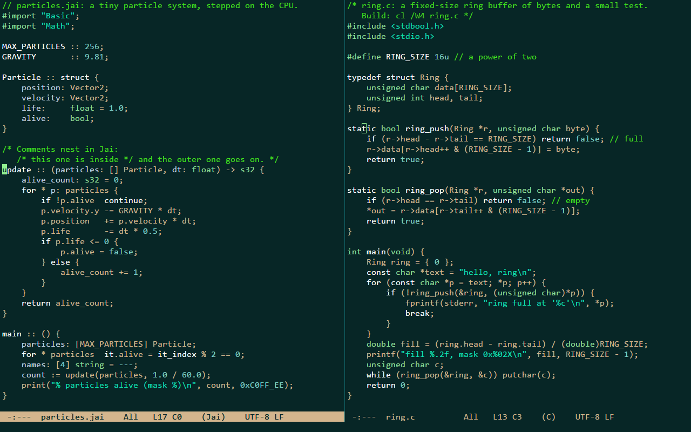
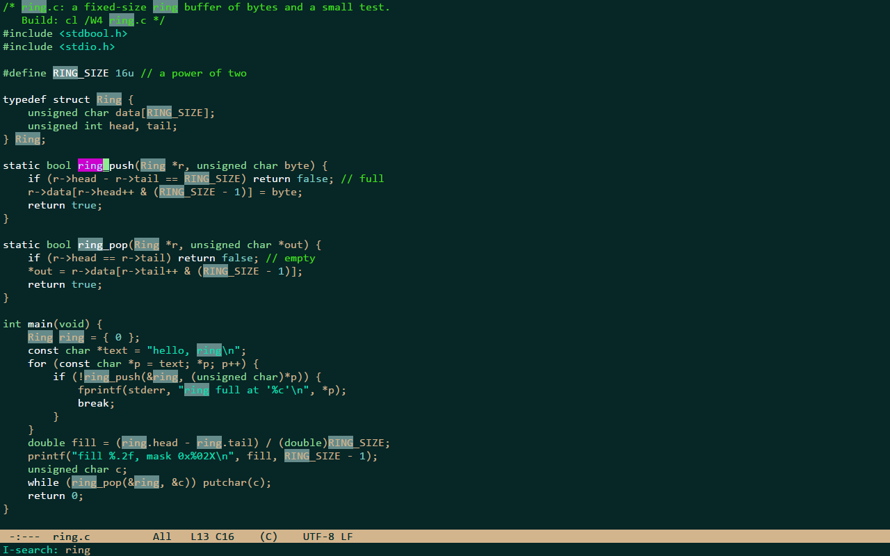
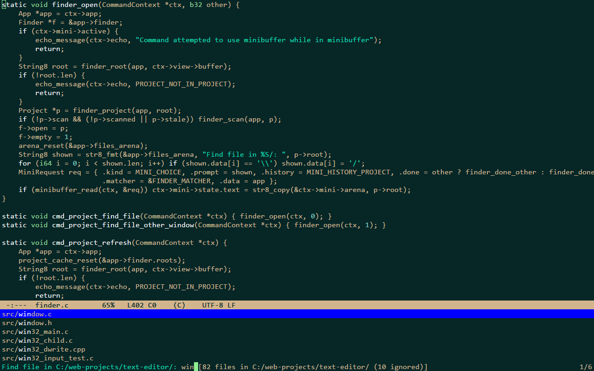
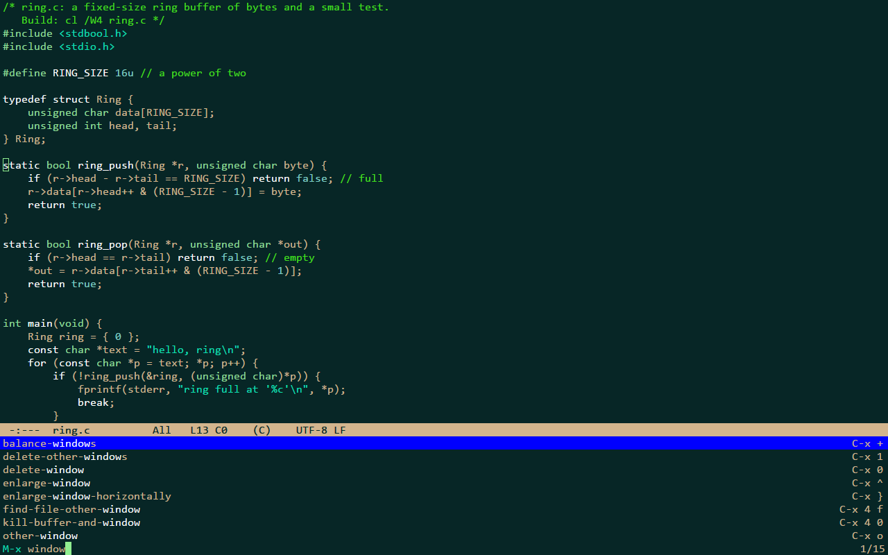
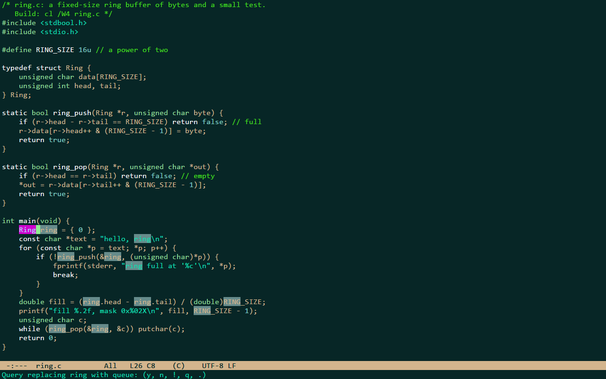

# teal

teal is a small native code editor for Windows, written in C. It follows the look and the model of
Emacs as Jonathan Blow uses it: no tabs, scroll bars, menus or toolbars; windows side by side, an
inverse-video mode line, a minibuffer, a block cursor, point and mark, a kill ring, incremental
search and M-x, with Emacs' default keys. It borrows ideas from the Focus and 4coder editors. The
goals, in order: low input latency and speed, a small and simple program, then features. It draws
with Direct3D 11 and DirectWrite, uses no third-party code, and draws a frame only when something
changed.



## Status

Early and experimental: teal is a learning project (see [How this project is
made](#how-this-project-is-made)). It is built in 15 phases (the roadmap is in [docs/ARCHITECTURE.md](docs/ARCHITECTURE.md#roadmap)).
Phases 1 to 12 are done: window and renderer, font, text buffer, views, commands and the config file,
editing, the minibuffer, syntax highlighting, isearch and query-replace, window splitting, projects
and fuzzy file open, project-wide search. Still to come: 13 build and jump to error, 14 multiple
cursors, 15 a performance and size pass.

Windows 10 or later, x64; developed and tested on Windows 11 only.

## Features

Only what exists today.

**Editing**
- Emacs editing model: point and mark, transient-mark-mode, shift-select, the kill ring (linked to
  the Windows clipboard), undo as in Emacs plus undo-redo, kill and yank commands, case and
  whitespace commands, transpose, comment-line, quoted-insert.
- Automatic indentation by rules on the lexer's tokens: RET, TAB (also on a region), a closing
  bracket or a case label typed first on a line; tabs or spaces detected per file.
- The mouse: click, drag to select, double click for a word, triple click for a line, the wheel.
- Files: UTF-8 (with or without BOM) and UTF-16 with BOM; LF, CRLF and mixed line endings are kept
  byte for byte; a 100 MB file loads in 35-40 ms. Saving writes a temporary file and swaps it in. Buffers whose file changed on disk are reloaded when they have no unsaved changes, and
  flagged otherwise. Quitting, and signing out of Windows, ask about unsaved buffers.

**Windows**
- Split below or to the right (up to 8 windows), each with its own point and scroll position; move
  between them, delete, balance and resize them with keys, or drag a divider or a mode line.
- Commands that show a buffer "in another window" (C-x 4 f, C-x 4 b) split or reuse a window.

**Minibuffer**
- M-x lists every command with its key binding, if it has one; find-file, switch-to-buffer, write-file, goto-line
  and kill-buffer prompt in the minibuffer with a vertical candidate list, history and completion.

**Search**
- isearch forward and backward with the other matches on screen highlighted, smart case, wrapping,
  the search ring, C-w / C-y to extend the search string.
- query-replace (M-%) and replace-string, with Emacs' case conversion; one undo takes back a whole
  session. Searches run in slices of at most 2 ms per frame, so typing is never blocked by a search
  in a large file.
- C-x p g searches every file of the project for literal text (smart case) on background threads and
  lists the matches in `*search*` as `path:line:column: text`, file names and line numbers in their
  own colors, the matched text highlighted. The list fills in while the search runs, always in the
  same order (the project's file order), whatever the number of threads; buffers with unsaved changes
  are searched as they are in teal; binary files are skipped; it stops at 10,000 matches and says so.
  A search opens each file only while it reads it, and shares it meanwhile, so saving, building or git
  are never blocked by it.
- M-s o (occur) lists the matches of the current buffer in `*occur*` the same way.
- In a results buffer RET visits a match in another window, n and p show the next and previous one
  there, g searches again and q closes the window; M-g n and M-g p (next-error, previous-error) walk
  the matches from any window.



**Projects**
- A project is the nearest directory above a file that holds `.git`, `.hg`, `.svn` or `.teal-project`,
  or a directory given on the command line. It is scanned on a background thread; `.gitignore` files
  (a subset of the syntax) and `.teal-project` decide what is listed.
- C-x p f finds a file by fuzzy matching its path; the list fills in while the scan runs. After files
  are added or removed, the project is scanned again the next time the finder needs it.



**Syntax highlighting**
- Hand-written lexers for Jai, C, C++, C#, JavaScript and TypeScript (chosen by the file
  extension, or with M-x set-language); comments, strings, numbers, keywords, types, constants,
  directives and some declarations. Highlighting is incremental: lines are lexed only as far
  as a window needs, with at most ~2 ms of that work per frame.
- The bracket at point and its match are highlighted (show-paren-mode).

**Configuration**
- One text file for settings, colors and key bindings, reloaded as soon as it is saved. Every key
  can be rebound. The text size can be changed for the session (C-x C-+, C-x C--, Ctrl + wheel).



## Numbers

Measured during development and recorded in [docs/ARCHITECTURE.md](docs/ARCHITECTURE.md) (the
"Measurements" sections). Machine: AMD Ryzen 7 7700X, a 2560x1440 display at 144 Hz, a 1280x800
window.

| what | value | where |
|---|---|---|
| executable size (release) | 416,768 bytes; imports only kernel32, user32, gdi32, d3d11, dwmapi and dwrite | Phase 12 |
| startup to the first frame on screen | ~174 ms median, of which 125-150 ms is waiting for `D3D11CreateDevice` (the driver) | Phases 9, 10 and 12 |
| typing: one keystroke's command plus building its frame | 9-20 us average, at line 1,000,000 of a 100 MB file | Phase 11 |
| idle | 0 frames and one 15.6 ms scheduler tick of CPU time in 5 s | Phase 11 |
| memory (private bytes, idle) | 76-77 MB with an empty buffer, ~67 MB of it Direct3D and the driver; 192-194 MB with a 100 MB file open | Phases 6 and 12 |
| loading a 100 MB file | 35-40 ms | Phase 3 |
| searching a project of 100 MB in 3,000 files (warm file cache) | 23-28 ms with 8 threads, the first result after ~2 ms; typing meanwhile as fast as without | Phase 12 |

The typing figure is CPU time inside teal; the time from a key press to the screen (input to
photon) has not been measured.

## Building

Requirements: Windows 10 or later, x64, and Visual Studio 2022 or later, or the Build Tools for
Visual Studio, with the "Desktop development with C++" workload (the MSVC x64 tools and the Windows
SDK, which provides `fxc`). `build.bat` finds MSVC through `vswhere` when `cl` is not on the PATH.

From a command prompt in the repository:

```bat
build.bat
build.bat release
build.bat bench
```

From Git Bash:

```bash
cmd //c ".\build.bat release"
```

| command | output | build |
|---|---|---|
| `build.bat` | `build\teal_debug.exe` | debug, with the dev flags and the D3D11 debug layer |
| `build.bat release` | `build\teal.exe` | optimized, no dev code |
| `build.bat bench` | `build\teal_bench.exe` | optimized, with the dev flags (tests and benchmarks) |

The build is a single unity translation unit (`src/teal.c`) plus one C++ file for DirectWrite.

## Usage

```
teal [[+LINE[:COLUMN]] file ...]
teal <directory> [[+LINE[:COLUMN]] file ...]
```

- Every file named is opened; the first one is shown. `+LINE[:COLUMN]` (1-based, as in Emacs) puts
  point there in the file that follows it.
- A directory is opened as the project: `*scratch*` and C-x C-f start there and C-x p f lists its
  files.
- A file that does not exist is opened as an empty buffer and created when saved.
- An unknown argument starting with `--` makes teal exit at once with code 10.

The test and benchmark flags of the dev builds are listed in [CLAUDE.md](CLAUDE.md).

## Keys

Keys are written as in Emacs: `C-` is Ctrl, `M-` is Alt (Meta), `S-` is Shift; `RET` is Enter,
`SPC` the space bar, `DEL` Backspace; `C-x C-s` means Ctrl+X, then Ctrl+S. Keys match by the
character they type in the current keyboard layout: `C-/` is Ctrl with whichever key types `/`.
One deliberate difference from Emacs: `ESC` is keyboard-quit, not a Meta prefix.

| keys | command |
|---|---|
| `C-f` `C-b` `C-n` `C-p` (or the arrows) | forward / backward a character, next / previous line |
| `C-a` `C-e` | beginning / end of the line |
| `M-f` `M-b` | forward / backward a word |
| `M-<` `M->` | beginning / end of the buffer |
| `C-v` `M-v` | scroll a screen down / up |
| `C-l` | recenter |
| `M-g g` | goto-line |
| `C-SPC` | set the mark |
| `C-w` `M-w` | kill (cut) / copy the region |
| `C-k` | kill to the end of the line |
| `C-y` `M-y` | yank (paste), then cycle through older kills |
| `C-/` `C-?` | undo / undo-redo |
| `TAB` | indent the line or the region |
| `M-;` | comment or uncomment the line or the region |
| `C-s` `C-r` | isearch forward / backward |
| `M-%` | query-replace |
| `C-x C-f` `C-x C-s` `C-x C-w` | find-file / save / write-file |
| `C-x b` `C-x k` | switch-to-buffer / kill-buffer |
| `C-x 2` `C-x 3` | split the window below / to the right |
| `C-x o` `C-x 0` `C-x 1` | other window / delete this window / delete the others |
| `C-x p f` | find a file in the project |
| `C-x p g` | search the project's files |
| `M-s o` | occur: the matches in this buffer |
| `M-g n` `M-g p` | next-error / previous-error: the next / previous match of the latest results |
| `M-x` | run a command by name |
| `C-g` | keyboard-quit (also cancels a prompt) |
| `C-h k` | describe the next key |
| `C-c ,` | open the config file |
| `C-x C-c` | quit (asks about unsaved buffers) |

Every key can be rebound in the config file; the complete list of default bindings, with comments,
is [src/config_default.h](src/config_default.h). M-x shows every command with its binding.

When several keyboard layouts are installed, Windows' input-language hotkey Left Alt+Shift can
switch the layout while you type a Meta key with Shift (such as `M-<` or `M-%`); turn that hotkey
off or change it in the Windows settings if it gets in the way.



## Configuration

teal reads `teal.conf` next to `teal.exe` if that file exists (a portable install), otherwise
`%APPDATA%\teal\teal.conf`. `C-c ,` opens it, creating it from the built-in defaults the first
time; the created file documents every setting, color and binding. teal reloads the file whenever
it is saved, from teal or from any other program (`C-c r` reloads it by hand). A file needs to
contain only what it changes; a bad line is skipped and reported in the echo area and in
`*Messages*`, and the rest still applies.

```
[colors]
background = #101c24
comment    = #7fbf7f

[keys]
C-c g       goto-line
```

The sections are `[settings]` (font, size, line height, ClearType mode, tab and indentation
widths, and more), `[colors]` and `[keys]` (plus `[keys minibuffer]`, `[keys isearch]` and
`[keys search-results]`). In
`[keys]` the last word of a line is the command; `none` removes a binding.

## Known limits

- Monospace text on a cell grid only: one cell per character, no proportional fonts, ligatures,
  bold or italic, no wide (East Asian) characters or emoji (they show as a box), no fallback font
  for characters the font lacks.
- No line wrapping (long lines scroll horizontally), no line numbers, no cursor blink, no smooth
  scrolling.
- No language server, no parser: highlighting and indentation come from hand-written lexers and
  simple rules, for six languages only. comment-line uses `//` in every language.
- Search is for literal text only: no regular expressions, no whole-word search, no project-wide
  replace. Results show 1-based byte columns (as grep does), and a location is the line and column
  where the match was found: editing the file above it moves the target. Case folding does not pair the Turkish
  dotted and dotless i.
- Not yet: building and jumping to errors, multiple cursors (phases 13-14).
- Emacs features that are missing: prefix arguments (`C-u`), the mark ring, rectangles, overwrite
  mode, auto-save and crash recovery, `ESC` as Meta.
- Encodings: UTF-8 and UTF-16 with a BOM; anything else (Windows-1252, Windows-1254 ...) is shown
  and saved as raw bytes. Files over 1 GB are refused.
- At most 8 windows. While the minibuffer is active, C-x o cannot leave it.
- `.gitignore` support is a subset: no character classes (`[a-z]`), no backslash escapes, no
  `.git/info/exclude` or global excludes file. In `.teal-project` a pattern cannot start with `[`
  (that line is a section header).
- Listing a directory on a slow network share in C-x C-f blocks the window until it is done.

The full list is the "Later" section of [docs/ARCHITECTURE.md](docs/ARCHITECTURE.md#later).

## How it is built

C11 compiled with MSVC, plus one file of C-style C++ for DirectWrite (its headers cannot be used
from C). No third-party code or libraries: only system DLLs. One `build.bat`, a unity build, no
project files. Memory comes from arenas over VirtualAlloc, with nothing allocated per keystroke or
frame; the program renders only when something changed and otherwise waits in
MsgWaitForMultipleObjectsEx. The editor core is platform-independent C behind two small headers;
only the `win32_*` files and the Direct3D renderer use Windows types.

Testing is built into the dev builds:
- `--test` runs without a window: differential fuzzing of the buffer, markers, the undo log and the
  search engine against simple reference implementations; a headless app driven by key sequences
  through the real keymap (commands, prompts, windows, isearch, the project finder, project-wide search
  and occur); the search over files against a whole-text reference and on generated trees with 1 to 8
  threads; file round trips; and a harness that posts real key messages through the window procedure on
  US, UK, Turkish Q and Finnish keyboard layouts.
- `--smoke` renders real frames and checks pixels (theme colors, the cursor, ClearType, the region,
  the minibuffer, isearch, windows, the finder, a results buffer), the D3D11 debug layer and leaks.
- Benchmarks (`--bench-*`) measure frames, typing, search, highlighting, project scans and the
  project-wide search on a 100 MB file or tree.
- `verify.bat` builds the three configurations, runs the smoke and the tests and prints one PASS or
  FAIL line; it is the gate before every commit.

The design, the decisions and the measurements are in [docs/ARCHITECTURE.md](docs/ARCHITECTURE.md);
every manual test step and what covers it is in [docs/MANUAL_TESTS.md](docs/MANUAL_TESTS.md).

## Credits

teal is inspired by Jonathan Blow's Emacs setup, whose colors are the default theme, and by the
Focus and 4coder editors and GNU Emacs (the editing model, the default keys, the command names and
many messages). The naysayer-theme for Emacs and the Witness color scheme served as references for
the colors. The fuzzy file finder's scoring weights follow fzf's. teal is not affiliated with or
endorsed by any of these projects or their authors.

## How this project is made

teal is a learning project. I am building it to learn how a text editor works, from the renderer
and the text buffer to the keymap and the search, and it was developed with the support of AI: the
code was written with Claude Code under my direction, one phase at a time. I review the source code
day by day and improve it as I come to understand each part of it. It is an experimental project,
not a finished product.

## License

MIT; see [LICENSE](LICENSE).
