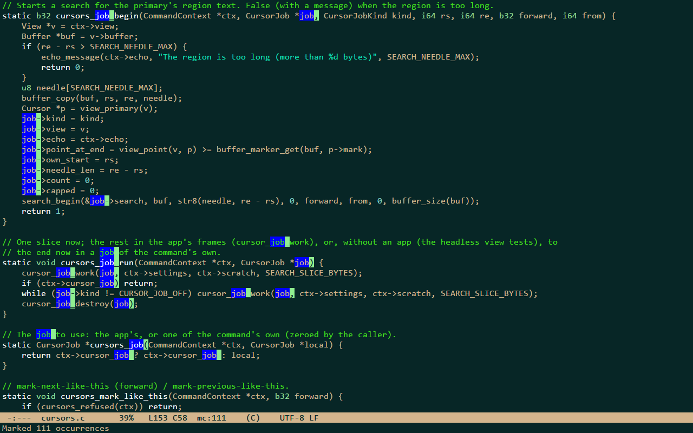
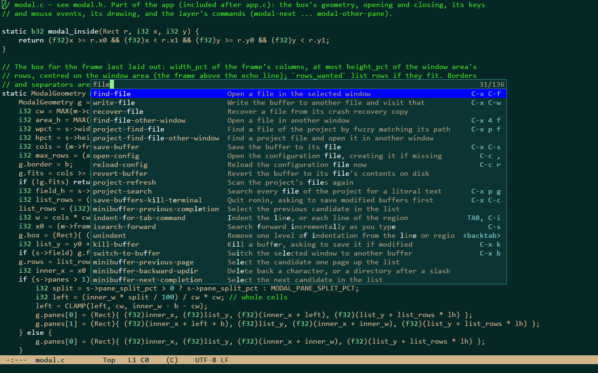
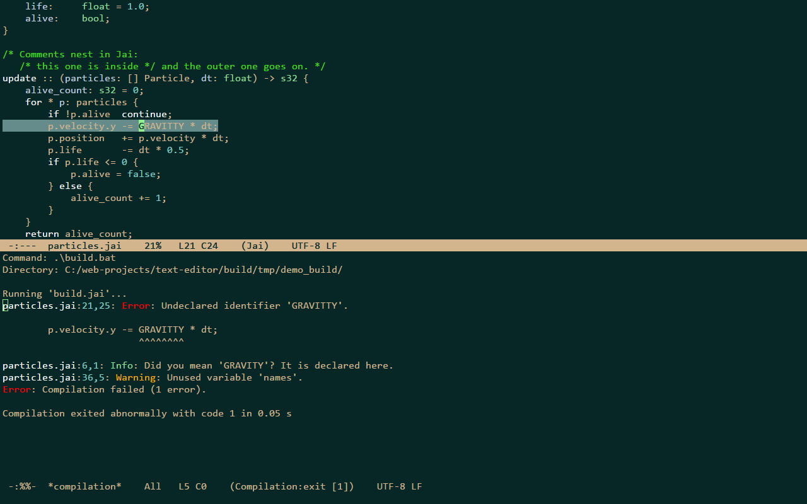

# ronin

ronin is a small, fast text editor for Windows, written in C, made for code. It follows the look and the model of
Emacs as Jonathan Blow uses it: no tabs, scroll bars, menus or toolbars; windows side by side, an
inverse-video mode line, a minibuffer, a block cursor, point and mark, a kill ring, incremental
search and M-x, with Emacs' default keys. It borrows ideas from the Focus and 4coder editors. The
goals, in order: low input latency and speed, a small and simple program, then features. It draws
with Direct3D 11 and DirectWrite, uses no third-party code, and draws a frame only when something
changed.


## Status

Version 0.1.0 ([CHANGELOG.md](CHANGELOG.md)), a pre-release. Early and experimental: ronin is a learning
project (see [How this project is made](#how-this-project-is-made)). What may come next is under
[Roadmap](#roadmap).

Windows 10 or later, x64; developed and tested on Windows 11 only.

## Features

Only what exists today.

**Editing**
- Emacs editing model: point and mark, transient-mark-mode, shift-select, the kill ring (linked to
  the Windows clipboard), undo as in Emacs plus undo-redo, kill and yank commands, case and
  whitespace commands, transpose, comment-line, quoted-insert.
- Automatic indentation by rules on the lexer's tokens: RET, TAB (also on a region), a closing
  bracket or a case label typed first on a line; tabs or spaces detected per file.
- The mouse: click, drag to select, double click for a word, triple click for a line, the wheel.
- Files: UTF-8 (with or without BOM) and UTF-16 with BOM; LF, CRLF and mixed line endings are kept
  byte for byte; a 100 MB file loads in 35-40 ms. Saving writes a temporary file and swaps it in. Buffers whose file changed on disk are reloaded when they have no unsaved changes, and
  flagged otherwise. Quitting, and signing out of Windows, ask about unsaved buffers.
- Crash recovery: if ronin crashes (an unhandled exception), every file buffer with unsaved changes is
  written to `%LOCALAPPDATA%\ronin\recovery` first, as saving would write it (its encoding, BOM and line
  endings), with a `.path` file naming the original. The next start says so in the echo area and lists the
  files in `*Messages*`; M-x recover-file shows the original and the recovered copy side by side. Nothing
  is overwritten and the files stay until you delete them. It is a best effort: see [Known limits](#known-limits).

**Multiple cursors**
- The commands of Emacs' multiple-cursors package (without its `mc/` prefix): `C->` adds a cursor at the
  next occurrence of the region's text (literal, case sensitive) with the same region, or, without a
  region, on the next line at the same column; `C-<` the same backwards; `C-c C-<` marks every occurrence
  (on a large file the search runs over several frames, `C-g` stops it); `C-S-c C-S-c` puts a cursor on
  every line of the region; Ctrl+Shift+click adds a cursor or removes the one there. Without keys:
  skip-to-next-like-this, unmark-next-like-this, edit-ends-of-lines, edit-beginnings-of-lines.
- Typing, motions, kills, yanks, indentation and the other editing commands act at every cursor, in one
  undo step that also brings every cursor back. Cursors that meet, or whose regions overlap, become one.
  A kill keeps one piece per cursor: a yank with as many cursors gives each its own piece, with another
  number the whole text; the clipboard gets the pieces one per line. Line commands (TAB, comment-line,
  kill-whole-line, M-^) act once per line.
- The new cursor of `C->` is the main one: the window follows it, the mode line shows its line and
  column and the number of cursors (`mc:3`). `C-g` first deactivates the regions, then leaves only the
  main cursor; isearch, query-replace, goto-line, `C-x h`, a plain click and switching buffers leave it
  alone too. At most `max_cursors` (10,000; up to 100,000).
- Typing at 10,000 cursors takes ~2 ms per key, command and frame, on a 100 MB file.



**Windows**
- Split below or to the right (up to 8 windows), each with its own point and scroll position; move
  between them, delete, balance and resize them with keys, or drag a divider or a mode line.
- Commands that show a buffer "in another window" (C-x 4 f, C-x 4 b) split or reuse a window.

**Minibuffer**
- M-x lists every command with its key binding, if it has one; find-file, switch-to-buffer, write-file, goto-line
  and kill-buffer prompt in the minibuffer with a vertical candidate list, history and completion.

**Command list**
- C-S-p opens a box over the windows that lists every command with a one-line description and its key
  bindings in the current window (the two shortest, then "+N"). Typing filters it with the fuzzy matcher of
  the project finder, on the name, the description, or both together ("occur lines"); names that match come
  first. Up / Down, C-n / C-p and C-v / M-v move the selection, the wheel scrolls, a click selects a row.
- RET (or a double click) closes the box and runs the selected command on the current window, exactly as
  M-x would: a command that asks for something (goto-line, find-file) asks in the minibuffer afterwards.
  C-g, ESC or a click outside close it and leave everything as it was. The filter line takes the usual
  line editing keys (C-a, C-k, M-DEL, C-y, ...); other commands are refused while the box is open.
- A keystroke filters the whole command table in ~8 us (median; 50-160 us at worst), allocating nothing.



**Search**
- isearch forward and backward with the other matches on screen highlighted, smart case, wrapping,
  the search ring, C-w / C-y to extend the search string.
- query-replace (M-%) and replace-string, with Emacs' case conversion; one undo takes back a whole
  session. Searches run in slices of at most 2 ms per frame, so typing is never blocked by a search
  in a large file.
- C-x p g searches every file of the project for literal text (smart case) on background threads and
  lists the matches in `*search*` as `path:line:column: text`, file names and line numbers in their
  own colors, the matched text highlighted. The list fills in while the search runs, always in the
  same order (the project's file order), whatever the number of threads; buffers with unsaved changes
  are searched as they are in ronin; binary files are skipped; it stops at 10,000 matches and says so.
  A search opens each file only while it reads it, and shares it meanwhile, so saving, building or git
  are never blocked by it.
- M-s o (occur) lists the matches of the current buffer in `*occur*` the same way.
- In a results buffer RET visits a match in another window, n and p show the next and previous one
  there, g searches again and q closes the window; M-g n and M-g p (next-error, previous-error) walk
  the matches from any window. Where they land stays highlighted until the next key.

**Building**
- C-x p c asks for a build command, with the one last used in the project (else the `[build]` command
  of `.ronin-project`) filled in to edit, and runs it through cmd.exe in the project's root (or the
  `[build]` directory): no console window, stdin empty, stdout and stderr together. Nothing runs before
  RET. M-x compile does the same in the current buffer's directory.
- The output fills `*compilation*` in another window (not selected) as it arrives, read on a background
  thread: typing is as fast during a build as without. Error lines of MSVC (cl, link, csc, tsc, MSBuild),
  GCC and Clang, Jai and tsc's pretty form are recognized when their file exists: the file and the line in
  the colors of `*search*`, "error" red, "warning" orange, notes green. Lines like `LINK : fatal error
  LNK1104` have no file position but are counted and colored too; a tool's own summary ("1 error
  generated.", "0 Error(s)") is colored but not counted. An absolute path under the project root is shown
  relative to it (`compilation_relative_paths`). ANSI colors are removed, the console's code page is
  converted.
- The mode line shows running, exit [0] or exit [N]; the last line and the echo area say how it ended
  ("Compilation finished: 2 errors, 3 warnings"). next-error and previous-error walk the errors (notes are
  skipped); in `*compilation*` RET, n, p and q work as in `*search*`, g runs the command again and C-c C-k
  kills it with every process it started (a job object), as does exiting ronin (it asks first).
- Before a build, buffers with unsaved changes are asked about (or all saved, or left:
  `compilation_save_buffers`); when it ends, buffers whose files it rewrote are reloaded at once (or
  flagged, when they have unsaved changes). The output kept is capped at 16 MB
  (`compilation_max_output_mb`), the rest is read and dropped.




**Projects**
- A project is the nearest directory above a file that holds `.git`, `.hg`, `.svn` or `.ronin-project`,
  or a directory given on the command line. It is scanned on a background thread; `.gitignore` files
  (a subset of the syntax) and `.ronin-project` decide what is listed.
- C-x p f finds a file by fuzzy matching its path; the list fills in while the scan runs. After files
  are added or removed, the project is scanned again the next time the finder needs it.


**Syntax highlighting**
- Hand-written lexers for Jai, C, C++, C#, JavaScript and TypeScript (chosen by the file
  extension, or with M-x set-language); comments, strings, numbers, keywords, types, constants,
  directives and some declarations. Highlighting is incremental: lines are lexed only as far
  as a window needs, with at most ~2 ms of that work per frame.
- The bracket at point and its match are highlighted (show-paren-mode).

**Configuration**
- One text file for settings, colors and key bindings, reloaded as soon as it is saved. Every key
  can be rebound. The text size can be changed for the session (C-x C-+, C-x C--, Ctrl + wheel).
- `early_window = true` shows the window in the background color about 40 ms after the start, before
  the graphics device is ready (the first frame follows at ~180 ms); off by default, where the window
  appears with its first frame.


## Numbers

Measured during development and recorded in [docs/ARCHITECTURE.md](docs/ARCHITECTURE.md) (the
"Measurements" sections). Machine: AMD Ryzen 7 7700X, a 2560x1440 display at 144 Hz, a 1280x800
window.

| what | value |
|---|---|
| executable size (release) | 422,400 bytes, the icon and the version resource included; no C runtime; imports only kernel32, user32 and gdi32 (d3d11, dwmapi and dwrite are loaded when first used) |
| startup to the first frame | 164 ms median from process creation to the first Present, of which ~146 ms is waiting for `D3D11CreateDevice` (the driver) on its own thread; with `early_window` the window is visible after ~40 ms |
| typing: one keystroke's command plus building its frame | 8-24 us average at line 1,000,000 of a 100 MB file; 23 us median for a key in *scratch* |
| typing: from the key's arrival to the screen | median 0.4 ms to Present; to the vertical blank that shows the frame 17 ms when DWM composes the window (about 2.5 refreshes at 144 Hz), 4.4-4.9 ms when DWM shows it directly (overlay) |
| typing at many cursors (consecutive lines of the 100 MB file), command plus frame | 1,000 cursors 0.2-0.4 ms, 10,000 cursors 1.7-2.1 ms |
| idle | 0 frames and 0 us of CPU time in 5 s, also right after a build, with 10,000 cursors and with the command list open |
| memory (private bytes, idle) | 57-59 MB with an empty buffer, ~3 MB of it our arenas and the rest mostly Direct3D and the driver; 174-175 MB with a 100 MB file open |
| loading a 100 MB file | 35-40 ms |
| searching a project of 100 MB in 3,000 files (warm file cache) | 23-28 ms with 8 threads, the first result after ~2 ms; typing meanwhile as fast as without |
| a build printing 100 MB as fast as it can | read into `*compilation*` in 0.33 s, no frame over 0.3 ms; typing meanwhile as fast as without |

The time to the screen is measured to the vertical blank that shows the frame (DXGI's frame statistics,
`--bench-latency`); the display's own scan-out and response come after it.

## Building

Requirements: Windows 10 or later, x64, and Visual Studio 2022 or later, or the Build Tools for
Visual Studio, with the "Desktop development with C++" workload (the MSVC x64 tools and the Windows
SDK, which provides `fxc` and `rc`). `build.bat` finds MSVC through `vswhere` when `cl` is not on the PATH.

From a command prompt in the repository:

```bat
build.bat
build.bat release
build.bat bench
```

From Git Bash:

```bash
cmd //c ".\build.bat release"
```

| command | output | build |
|---|---|---|
| `build.bat` | `build\ronin_debug.exe` | debug, with the dev flags and the D3D11 debug layer |
| `build.bat release` | `build\ronin.exe` | optimized, no dev code |
| `build.bat bench` | `build\ronin_bench.exe` | optimized, with the dev flags (tests and benchmarks) |
| `build.bat clean` | nothing | removes `build\` and `dist\`, everything generated, and nothing else |

Everything a build, the tests or `dist.bat` make goes to `build\` or `dist\`; nothing else in the
repository is generated, and a fresh clone needs only `build.bat`. `build.bat clean` refuses (exit code 10,
nothing removed) when it is not in ronin's repository root or when `build\` or `dist\` is a junction or a
link.

The build is a single unity translation unit (`src/ronin.c`) plus one C++ file for DirectWrite. The
icon is drawn by a small program, `tools/make_icon.c`, that every build compiles and runs; with the
version (`src/version.h`) it goes into the exe through `res/ronin.rc`. `dist.bat` runs `verify.bat`
and packs `dist\ronin-0.1.0-windows-x64.zip` (ronin.exe, this README and the license).

## Usage

```
ronin [[+LINE[:COLUMN]] file ...]
ronin <directory> [[+LINE[:COLUMN]] file ...]
```

- Every file named is opened; the first one is shown. `+LINE[:COLUMN]` (1-based, as in Emacs) puts
  point there in the file that follows it.
- A directory is opened as the project: `*scratch*` and C-x C-f start there and C-x p f lists its
  files.
- A file that does not exist is opened as an empty buffer and created when saved.
- `ronin --version` prints "ronin 0.1.0" and exits.
- An unknown argument starting with `--` makes ronin exit at once with code 10.

`samples/` has one small file per language (C, C++, C#, JavaScript, TypeScript and Jai) to try the
highlighting and the indentation on, e.g. `ronin samples\ring.c`.

The test and benchmark flags of the dev builds are listed in [CLAUDE.md](CLAUDE.md).

## Keys

Keys are written as in Emacs: `C-` is Ctrl, `M-` is Alt (Meta), `S-` is Shift; `RET` is Enter,
`SPC` the space bar, `DEL` Backspace; `C-x C-s` means Ctrl+X, then Ctrl+S. Keys match by the
character they type in the current keyboard layout: `C-/` is Ctrl with whichever key types `/`.
One deliberate difference from Emacs: `ESC` is keyboard-quit, not a Meta prefix.

| keys | command |
|---|---|
| `C-f` `C-b` `C-n` `C-p` (or the arrows) | forward / backward a character, next / previous line |
| `C-a` `C-e` | beginning / end of the line |
| `M-f` `M-b` | forward / backward a word |
| `M-<` `M->` | beginning / end of the buffer |
| `C-v` `M-v` | scroll a screen down / up |
| `C-l` | recenter |
| `M-g g` | goto-line |
| `C-SPC` | set the mark |
| `C->` `C-<` (on a US keyboard Ctrl+Shift+. and Ctrl+Shift+,) | a cursor at the next / previous occurrence of the region, or on the next / previous line |
| `C-c C-<` | a cursor at every occurrence of the region |
| `C-S-c C-S-c` | a cursor on every line of the region |
| Ctrl+Shift+click | add a cursor, or remove the one there |
| `C-w` `M-w` | kill (cut) / copy the region |
| `C-k` | kill to the end of the line |
| `C-y` `M-y` | yank (paste), then cycle through older kills |
| `C-/` `C-?` | undo / undo-redo |
| `TAB` | indent the line or the region |
| `M-;` | comment or uncomment the line or the region |
| `C-s` `C-r` | isearch forward / backward |
| `M-%` | query-replace |
| `C-x C-f` `C-x C-s` `C-x C-w` | find-file / save / write-file |
| `C-x b` `C-x k` | switch-to-buffer / kill-buffer |
| `C-x 2` `C-x 3` | split the window below / to the right |
| `C-x o` `C-x 0` `C-x 1` | other window / delete this window / delete the others |
| `C-x p f` | find a file in the project |
| `C-x p g` | search the project's files |
| `M-s o` | occur: the matches in this buffer |
| `C-x p c` | build the project (`*compilation*`; there: `g` again, `C-c C-k` kill) |
| `M-g n` `M-g p` | next-error / previous-error: the next / previous match or error of the latest results |
| `M-x` | run a command by name |
| `C-S-p` | the command list: every command with what it does and its keys; type to filter, `RET` runs |
| `C-g` | keyboard-quit (also cancels a prompt; with several cursors: their regions, then the extra cursors) |
| `C-h k` | describe the next key |
| `C-c ,` | open the config file |
| `C-x C-c` | quit (asks about unsaved buffers) |

Every key can be rebound in the config file; the complete list of default bindings, with comments,
is [src/config_default.h](src/config_default.h). M-x shows every command with its binding, C-S-p with its description
too. Unlike Emacs, `C-S-p` is not a shift-selecting `C-p` (`S-<up>` still is).

When several keyboard layouts are installed, Windows' input-language hotkey Left Alt+Shift can
switch the layout while you type a Meta key with Shift (such as `M-<` or `M-%`); turn that hotkey
off or change it in the Windows settings if it gets in the way.


## Configuration

ronin reads `ronin.conf` next to `ronin.exe` if that file exists (a portable install), otherwise
`%APPDATA%\ronin\ronin.conf`. `C-c ,` opens it, creating it from the built-in defaults the first
time; the created file documents every setting, color and binding. ronin reloads the file whenever
it is saved, from ronin or from any other program (`C-c r` reloads it by hand). A file needs to
contain only what it changes; a bad line is skipped and reported in the echo area and in
`*Messages*`, and the rest still applies.

```
[colors]
background = #101c24
comment    = #7fbf7f

[keys]
C-c g       goto-line
```

The sections are `[settings]` (font, size, line height, ClearType mode, tab and indentation
widths, and more), `[colors]` and `[keys]` (plus `[keys minibuffer]`, `[keys isearch]`,
`[keys search-results]`, `[keys compilation]` and `[keys command-list]`, the keys while the command list is
open). The command list's box has its own colors: `modal_background`, `modal_border`, `modal_selection`,
`modal_description` and `modal_key`. In
`[keys]` the last word of a line is the command; `none` removes a binding. To run the last build
again with one key:

```
[keys]
F5          recompile
```

A project's build command goes into `.ronin-project` at its root (C-x p c offers it; it never runs on
its own):

```
[build]
command   = .\build.bat release
directory = src
```

`directory` is relative to the root and optional. Write `.\build.bat` rather than `build.bat`: cmd does
not look in the current directory when the environment sets `NoDefaultCurrentDirectoryInExePath`.

## Known limits

- Monospace text on a cell grid only: one cell per character, no proportional fonts, ligatures,
  bold or italic, no wide (East Asian) characters or emoji (they show as a box), no fallback font
  for characters the font lacks.
- No line wrapping (long lines scroll horizontally), no line numbers, no cursor blink, no smooth
  scrolling.
- No language server, no parser: highlighting and indentation come from hand-written lexers and
  simple rules, for six languages only. comment-line uses `//` in every language.
- Search is for literal text only: no regular expressions, no whole-word search, no project-wide
  replace. Results show 1-based byte columns (as grep does), and a location is the line and column
  where the match was found: editing the file above it moves the target. Case folding does not pair the Turkish
  dotted and dotless i.
- Multiple cursors: one kill ring for all of them (a kill keeps a piece per cursor in one entry); M-x cannot
  run inside a prompt, so the commands without keys need a binding there; while a large mark-all runs, other
  keys wait for it. Cursors spread over a whole 100 MB file cost ~20 ms per key (the text between them
  moves); RET at thousands of cursors on lines with unbalanced braces far apart costs ~0.5 ms per cursor
  (the indentation's bracket search).
- A line of several megabytes (minified code) is slower to work on: ~0.4-1.1 ms a key to type or move
  on a 5 MB line.
- Builds: one at a time (`*compilation*`), no input to the process, one build command per project, no
  "Entering directory" tracking, and only the built-in error formats. A line shows when its newline
  arrives (a progress line without one waits). Error locations are the line and column as printed.
- Emacs features that are missing: prefix arguments (`C-u`), the mark ring, rectangles, overwrite
  mode, auto-save, `ESC` as Meta.
- Crash recovery is a best effort. It runs only for a crash inside ronin (an unhandled exception):
  nothing is written when the process is ended from outside (Task Manager) or the machine loses power. A crash on a background thread is handled on that thread while the main thread
  may still be editing, so a buffer can be caught mid-edit. Recovery files are never deleted by ronin.
- Encodings: UTF-8 and UTF-16 with a BOM; anything else (Windows-1252, Windows-1254 ...) is shown
  and saved as raw bytes. Files over 1 GB are refused.
- At most 8 windows. While the minibuffer is active, C-x o cannot leave it.
- `.gitignore` support is a subset: no character classes (`[a-z]`), no backslash escapes, no
  `.git/info/exclude` or global excludes file. In `.ronin-project` a pattern cannot start with `[`
  (that line is a section header).
- Listing a directory on a slow network share in C-x C-f blocks the window until it is done.
- The command list shows the bindings of the current window's keymaps, not those of the minibuffer or
  isearch; its filter uses the first 256 bytes typed. describe-key and M-x do not show the descriptions yet.

The full list is the "Later" section of [docs/ARCHITECTURE.md](docs/ARCHITECTURE.md#later).

## Roadmap

What is planned, from the "Later" list in [docs/ARCHITECTURE.md](docs/ARCHITECTURE.md#later); none of it has
a date.

Likely, in no fixed order:
- Editing: auto-save, prefix arguments (`C-u`), the mark ring, rectangles, `ESC` as Meta.
- Search: regular expressions, whole-word search, project-wide replace, a match count in isearch.
- Text: legacy code pages and UTF-16 without a BOM, wide (East Asian) characters and emoji, a fallback
  font for missing characters, line numbers.
- Speed on extreme input: a column cache for multi-megabyte lines, a per-line bracket summary for RET
  among unbalanced braces, processing cursors from the gap's side on a 100 MB file, saving on a
  background thread (a save waits for ReplaceFileW: 5-7 ms, once 146 ms in a million soak events).
- Projects and builds: an index kept current from change notifications, run and debug commands, several
  build commands per project, user-defined error formats.
- Windows: window configurations (undo of window changes).

Not planned (by design): a language server or tree-sitter, proportional fonts, ligatures, bold and
italic, tabs, menus, toolbars and scroll bars. Tried and left out because they measured no
better: a waitable swap chain and Present(0, 0) for input latency, other `D3D11CreateDevice` options for
startup.

## How it is built

C11 compiled with MSVC, plus one file of C-style C++ for DirectWrite (its headers cannot be used
from C). No third-party code or libraries: only system DLLs. The release build links no C runtime (its
own entry point; of the compiler's libraries only the copy routines and the stack probe). One `build.bat`, a unity build, no
project files. Memory comes from arenas over VirtualAlloc, with nothing allocated per keystroke or
frame; the program renders only when something changed and otherwise waits in
MsgWaitForMultipleObjectsEx. The editor core is platform-independent C behind two small headers;
only the `win32_*` files and the Direct3D renderer use Windows types.

Testing is built into the dev builds:
- `--test` runs without a window: differential fuzzing of the buffer, markers, the undo log and the
  search engine against simple reference implementations; a headless app driven by key sequences
  through the real keymap (commands, prompts, windows, isearch, the project finder, project-wide search,
  occur and builds); the search over files against a whole-text reference and on generated trees with 1 to 8
  threads; the error matchers' golden lines; builds of a scripted child program (output, exit codes,
  kills of the whole process tree, 100 start / kill rounds); a differential fuzz of multiple cursors against
  the one-cursor commands applied cursor by cursor; file round trips; a crashing child process whose
  recovery files must equal a save byte for byte; and a harness that posts
  real key messages through the window procedure on US, UK, Turkish Q and Finnish keyboard layouts.
- `--fuzz-seeds` runs every seeded test group for hundreds of seeds; `--soak` sends a million random keys,
  clicks and resizes through the app, checking its invariants, its memory, its handles and threads and its
  speed as it goes.
- `--leak-check` repeats 24 operations (files, windows, prompts, searches, the project finder, project
  searches, builds, multiple cursors, the command list, undo, config reloads, files changed on disk) hundreds of times and
  checks that memory, handles, threads, the glyph atlas and Direct3D objects stop growing; every exit of a
  dev build checks that nothing of ronin's is left (Direct3D objects, memory, handles).
- `--smoke` renders real frames and checks pixels (theme colors, the cursor, ClearType, the region,
  the minibuffer, isearch, windows, the finder, a results buffer, a build, three cursors, the command list
  and the frame under it after it closes), the D3D11 debug layer and
  leaks (processes, threads and handles too).
- Benchmarks (`--bench-*`) measure frames, typing, search, highlighting, project scans, the
  project-wide search, a build's output, typing at up to 10,000 cursors on a 100 MB file or tree, and the
  command list's filter.
- `verify.bat` builds the three configurations, checks `build.bat clean` on a scratch tree, runs the
  smoke and the tests, checks the release exe's imported DLLs against a committed list and prints one
  PASS or FAIL line; it is the gate before every
  commit. `verify.bat phase` adds the seed sweep, the soak and the leak check.

The design, the decisions and the measurements are in [docs/ARCHITECTURE.md](docs/ARCHITECTURE.md);
every manual test step and what covers it is in [docs/MANUAL_TESTS.md](docs/MANUAL_TESTS.md).

## Credits

ronin is inspired by Jonathan Blow's Emacs setup, whose colors are the default theme, and by the
Focus and 4coder editors and GNU Emacs (the editing model, the default keys, the command names and
many messages). The naysayer-theme for Emacs and the Witness color scheme served as references for
the colors. The fuzzy file finder's scoring weights follow fzf's. ronin is not affiliated with or
endorsed by any of these projects or their authors.

## How this project is made

ronin is a learning project. I am building it to learn how a text editor works, from the renderer
and the text buffer to the keymap and the search, and it was developed with the support of AI: the
code was written with Claude Code under my direction, one phase at a time. I review the source code
day by day and improve it as I come to understand each part of it. It is an experimental project,
not a finished product.

## License

MIT; see [LICENSE](LICENSE).
