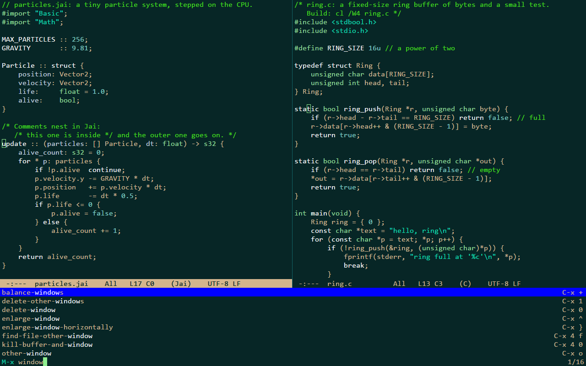
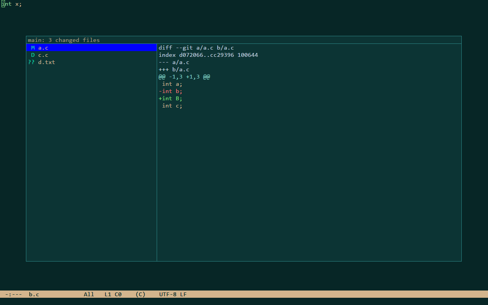
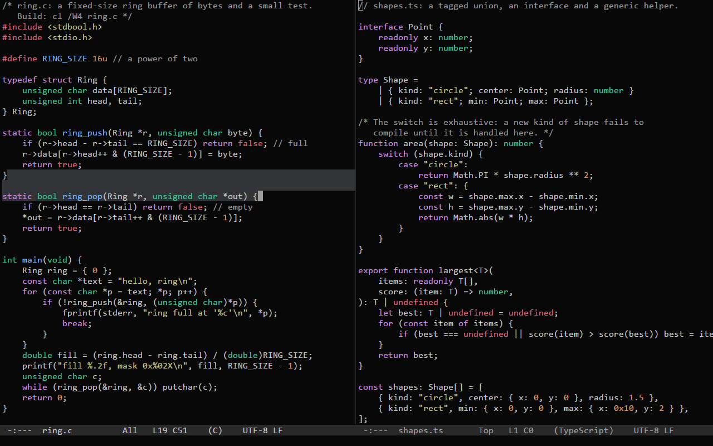

<h1 align="center">ronin</h1>

A small, fast, Emacs-style code editor for Windows, written in C with no dependencies.

ronin keeps three goals in a fixed order: input latency and speed first, a small and simple program second, features
third. A keystroke's command and its frame take about 20 microseconds, an idle ronin uses no CPU, and the whole editor
is one executable of under half a megabyte that needs nothing but Windows. It looks and works like Emacs as Jonathan
Blow uses it, with ideas from the Focus and 4coder editors: no tabs, menus or scroll bars, but windows side by side, a
minibuffer and Emacs' keys.

**[Download](https://github.com/Bskasan/ronin-text-editor/releases/latest)** · **[Documentation](https://bskasan.github.io/ronin-text-editor/)**

| The command list | The git changes view | Five themes |
|---|---|---|
|  |  |  |
| `C-S-p` lists every command with what it does and its keys; type to filter, `RET` runs the selected one. | `C-x g` shows the project's uncommitted changes and each file's diff, colored, in a box over the windows. | Five dark themes are built in, `M-x set-theme` tries them, and a theme of your own is a short text file. |

If ronin crashes, it first writes its unsaved changes to recovery files, and the next start offers them
(`M-x recover-file`). A power loss, or ronin ended from outside (Task Manager, a forced shutdown), loses unsaved
changes: there is no auto-save yet ([#11](https://github.com/Bskasan/ronin-text-editor/issues/11)).

## Keys

Emacs' default keys: `C-` is Ctrl, `M-` is Alt, and `C-x C-s` means Ctrl+X, then Ctrl+S. Every key can be rebound.

| keys | command | what it does |
|---|---|---|
| `C-x C-f` | `find-file` | open a file, with completion |
| `C-x C-s` | `save-buffer` | save |
| `C-g` | `keyboard-quit` | cancel whatever is going on |
| `C-/` `C-?` | `undo` `undo-redo` | undo, and go forward again |
| `C-s` `C-r` | `isearch-forward` `isearch-backward` | search as you type |
| `C-x p f` | `project-find-file` | find a file of the project by fuzzy matching its path |
| `M-x` | `execute-extended-command` | run any command by name |
| `C-S-p` | `show-command-list` | every command, what it does and its keys |

Every command and its default keys are on the [keys page](https://bskasan.github.io/ronin-text-editor/keys.html).

## Install

1. Download `ronin-<version>-windows-x64.zip` from [Releases](https://github.com/Bskasan/ronin-text-editor/releases/latest) and unzip it anywhere; there is no installer.
2. Run `ronin.exe` (Windows 10 or later, x64). It is not signed: if SmartScreen says "Windows protected your PC", choose **More info**, then **Run anyway**.
3. From a terminal: `ronin file.c`, `ronin +120:8 file.c` or `ronin C:\code\project`; the [install page](https://bskasan.github.io/ronin-text-editor/install.html) has the rest.

## Contributing

Bug reports and pull requests are welcome: read [CONTRIBUTING.md](CONTRIBUTING.md) first. The design, every decision and every measurement are in [docs/ARCHITECTURE.md](docs/ARCHITECTURE.md).

## License and credits

MIT; see [LICENSE](LICENSE). ronin is inspired by Jonathan Blow's Emacs setup, whose colors are the default theme, by the Focus and 4coder editors, and by GNU Emacs (the editing model, the default keys, the command names and many messages); the fuzzy finder's scoring weights follow fzf's. ronin is not affiliated with or endorsed by any of these projects or their authors. The four ported themes are credited in [THIRD_PARTY.md](THIRD_PARTY.md).
